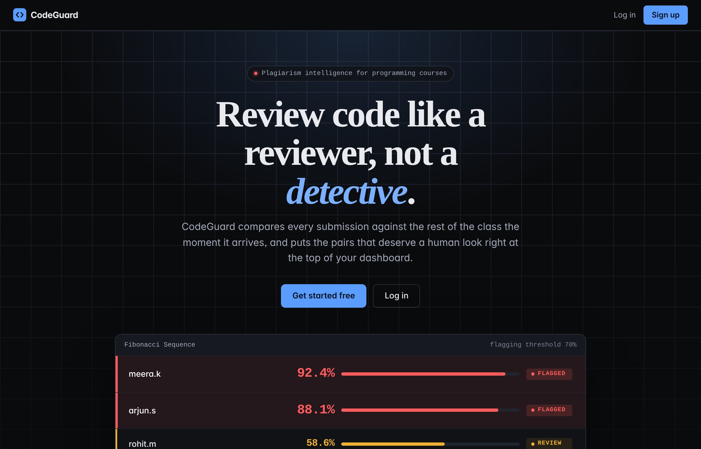
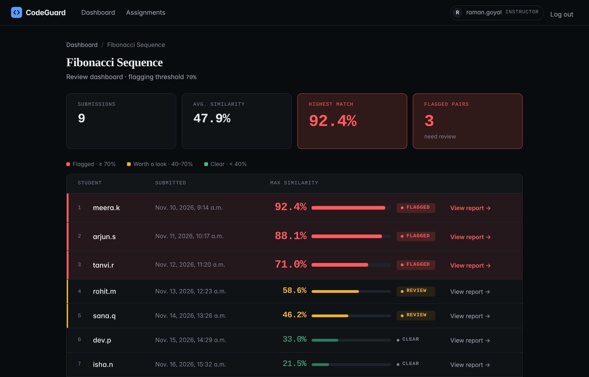
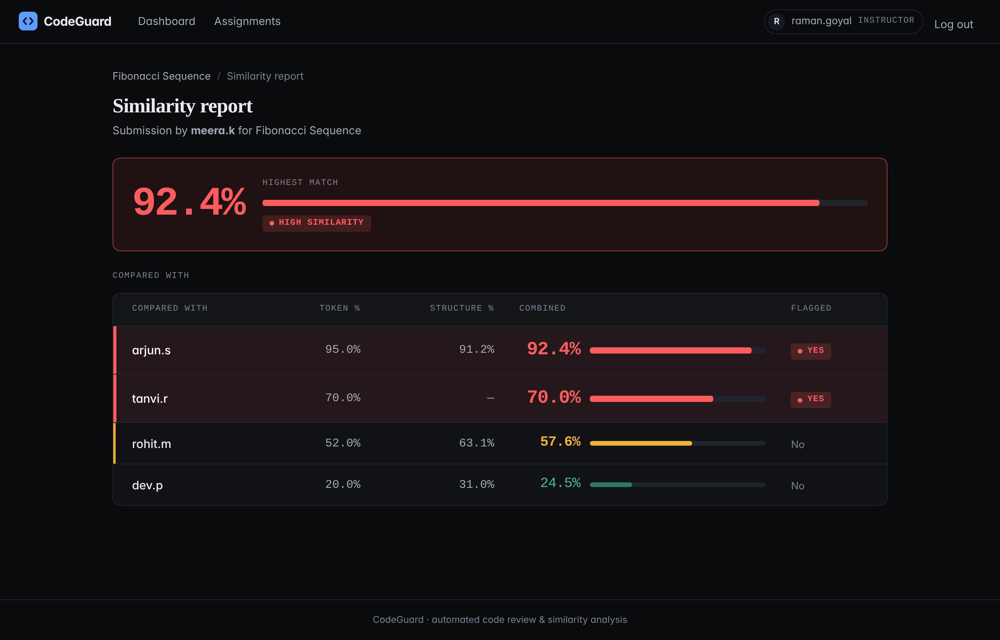
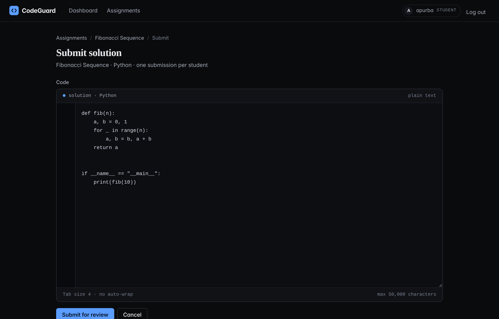
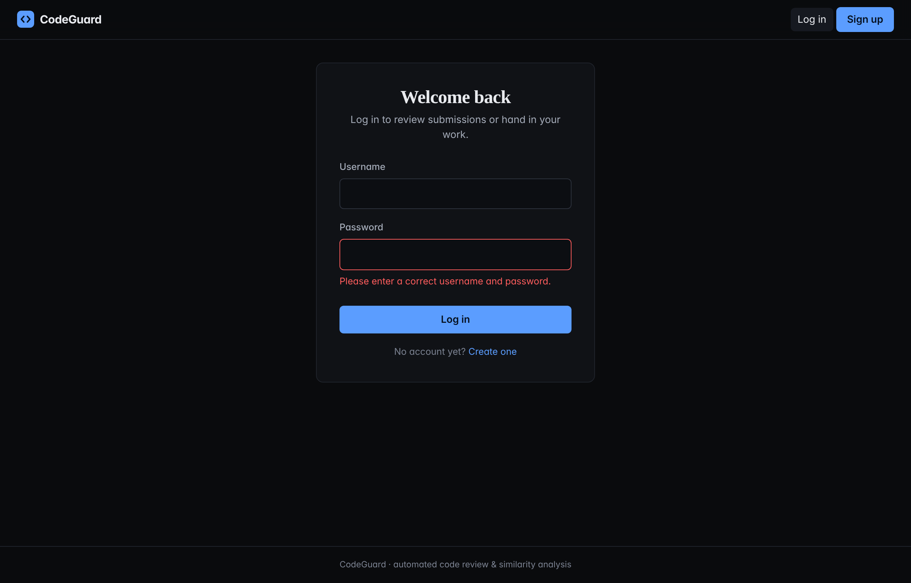
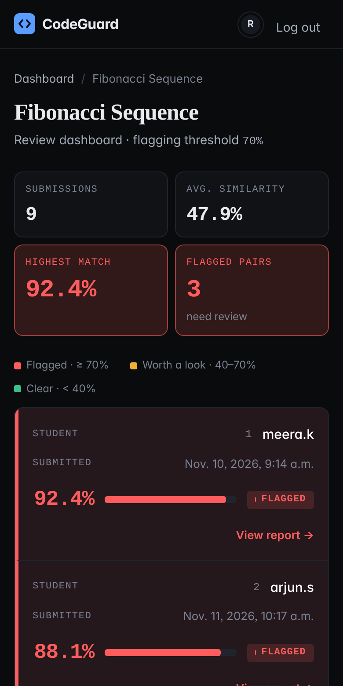

<div align="center">

# CodeGuard

**Automated code review and plagiarism intelligence for programming courses.**

Every submission is compared against the rest of the class the moment it arrives.
The pairs that deserve a human look go straight to the top of the instructor's dashboard.

[**Live demo**](https://YOUR-DEPLOYED-LINK) &nbsp;·&nbsp; [Features](#features) &nbsp;·&nbsp; [Quickstart](#quickstart) &nbsp;·&nbsp; [How the similarity engine works](#how-the-similarity-engine-works)




</div>

---

## Why CodeGuard?

Checking dozens of submissions against each other by hand is slow, and a student who renames a few variables can slip past a plain text diff. CodeGuard scores every pair automatically using two independent signals, then shows instructors the riskiest submissions first so their time goes where it matters.

> A high score is **evidence for a human reviewer, not a verdict**. CodeGuard never decides that plagiarism happened.

## Features

| | |
|---|---|
| **Two-signal similarity engine** | Token similarity for any language, plus syntax-tree structure similarity for Python. |
| **Rename-proof** | Identifiers are normalized, so changing variable and function names does not hide a copy. |
| **Risk-first dashboard** | Flagged submissions are tinted, edged and enlarged. Clear ones fade back. |
| **Per-pair reports** | Token, structure and combined scores for every comparison, so you can see why something was flagged. |
| **Role-based access** | Students see only their own report. Instructors see every report and the full dashboard. |
| **Editor-style submissions** | Monospace code box with line height, tab size and no soft wrap. One submission per student, closed at the deadline. |
| **Secure by default** | CSRF-protected forms, hashed passwords, session login. Submitted code is stored as text and is never executed. |
| **Responsive** | Works from 320 px phones to desktops. Tables turn into stacked cards on small screens. |

## Screenshots

<table>
  <tr>
    <td width="50%"><b>Instructor review dashboard</b><br></td>
    <td width="50%"><b>Similarity report</b><br></td>
  </tr>
  <tr>
    <td width="50%"><b>Code submission</b><br></td>
    <td width="50%"><b>Log in</b><br></td>
  </tr>
</table>

<p align="center"><b>On mobile</b><br></p>

## Quickstart

You need **Python 3.10+** and **pip**.

```bash
# 1. get the code
git clone https://github.com/YOUR-USERNAME/codeguard.git
cd codeguard

# 2. create and activate a virtual environment
python -m venv venv
venv\Scripts\activate            # Windows
# source venv/bin/activate       # macOS / Linux

# 3. install and set up
pip install -r requirements.txt
python manage.py migrate

# 4. run
python manage.py runserver
```

Open <http://127.0.0.1:8000/>. To use the Django admin as well, run `python manage.py createsuperuser` and visit `/admin/`.

### Try the full flow in two minutes

1. Sign up one **Instructor** and two **Student** accounts at `/accounts/signup/`.
2. As the instructor, click **New assignment** and create one.
3. As Student A, submit a solution.
4. As Student B, submit the **same logic with renamed variables**.
5. Log in as the instructor and open the assignment. Student B appears as a red, **flagged** row at the top.

## How the similarity engine works

Code lives in [`submissions/similarity.py`](submissions/similarity.py).

| Signal | Applies to | What it does |
|---|---|---|
| **Token similarity** | Any language | Strips comments and whitespace, replaces every user-defined identifier with a placeholder, then computes the Jaccard similarity of the two token sets. |
| **Structure similarity** | Python only | Parses each submission into an AST, reduces it to a sequence of node types, then compares the sequences with `difflib.SequenceMatcher`. |

```
combined = 0.4 × token + 0.6 × structure      (Python code that parses)
combined = token                              (everything else)
```

A pair is **flagged** when `combined` is at or above the assignment's threshold (70% by default).

```python
from submissions.similarity import compare_submissions

a = "def fib(n):\n    a, b = 0, 1\n    for _ in range(n):\n        a, b = b, a + b\n    return a"
b = "def fibonacci(count):\n    prev, cur = 0, 1\n    for i in range(count):\n        prev, cur = cur, prev + cur\n    return prev"

compare_submissions(a, b)
# {'token_similarity': 100.0, 'structure_similarity': 100.0, 'combined_score': 100.0}
```

A genuinely different (recursive) solution to the same problem scores about **46%**.

### Limitations

- The engine does not execute code and does not compare against anything outside the platform.
- Structural analysis needs Python that parses. Other languages use token similarity only.
- Comparison runs inside the submit request, which is fine for classroom-sized assignments. Much larger classes would need a background worker.

## Roles

| Role | Can do |
|---|---|
| **Student** | Browse assignments, submit once before the deadline, view their own similarity report. |
| **Instructor** | Create assignments, open the review dashboard, view any submission's report. |
| **Admin** | Manage users, assignments and flagged pairs in Django Admin. |

## Routes

| URL | Purpose |
|---|---|
| `/` | Landing page (signed-in users go straight to the dashboard) |
| `/dashboard/` | Role-specific home |
| `/accounts/signup/` · `/accounts/login/` · `/accounts/logout/` | Authentication |
| `/assignments/` · `/assignments/new/` · `/assignments/<slug>/` | Assignment list, create (instructor), detail |
| `/submissions/<slug>/submit/` | Submit code |
| `/submissions/report/<id>/` | Similarity report |
| `/submissions/<slug>/dashboard/` | Instructor review dashboard |

## Project structure

```
codeguard/
├── accounts/          Role-based auth (Student / Instructor) on Django's User
├── assignments/       Assignment model, forms and views
├── submissions/       Submissions, similarity engine, reports, instructor dashboard
├── codeguard/         Project settings and root URLs
├── core_views.py      Landing page and role-based dashboard router
├── templates/         Django templates (one base.html extended by every page)
├── static/css/        styles.css, the whole design system in one file
└── docs/screenshots/  Images used in this README
```

## Design

The interface is a dark, developer-tool style UI built with **plain CSS: no framework, no build step**.

- **Colour:** one cool-grey neutral ramp, one blue accent used only for interactive elements, and red / amber / green used *only* to mean similarity risk. Any colour on the dashboard therefore means "look here".
- **Type:** Inter for the interface, Source Serif 4 for headlines, JetBrains Mono for scores and code. Fonts load from Google Fonts and fall back to system fonts when offline.
- **Accessibility:** visible focus rings, text labels alongside colour, and reduced-motion support.
- All tokens (colour, spacing, type) live in a single `:root` block at the top of `static/css/styles.css`.

## Tech stack

Python · Django 5 · SQLite · Django Template Language · plain CSS

## Where each Django concept lives

| Concept | Where |
|---|---|
| Project and app structure | Three apps plus `core_views.py` |
| URLs, views, HTTP, errors | Slug-based URLs, GET/POST branching in `submit_code`, `get_object_or_404` |
| Templates and inheritance | `templates/base.html` extended by every page; `` / `` drive the badges and tables |
| Forms, CSRF, validation | `SignUpForm`, `AssignmentForm`, `SubmissionForm` with `clean_*` methods; `` on every POST form |
| Models, ORM, admin | `Profile`, `Assignment`, `Submission`, `SimilarityReport` with constraints; `Count` / `Avg` / `Max` on the dashboard |
| Sessions and auth | Django auth views, `login_required`, role checks through `request.user.profile` |

## Author

Built by **Apurba Bhaumik** as a course project. Submitted to Raman Goyal.

Source: <https://github.com/YOUR-USERNAME/codeguard> &nbsp;·&nbsp; Live: <https://YOUR-DEPLOYED-LINK>
# codeguard

# codeguard

